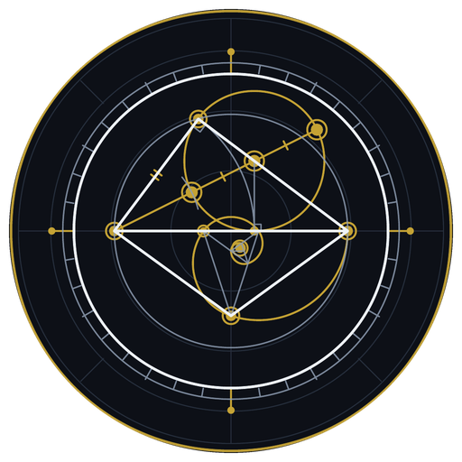
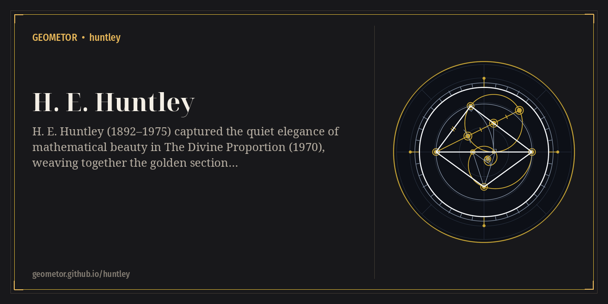

<a href="https://geometor.github.io/huntley/"></a>

# GEOMETOR • huntley

**Visit the Online Archive:** https://geometor.github.io/huntley/

<p align="center">
  <a href="https://geometor.github.io/huntley/"></a>
</p>

**H. E. Huntley • The Divine Proportion • semantic digital archive**

## Mission

`geometor/huntley` is part of the interconnected [GEOMETOR](https://geometor.com) semantic digital archive. It provides an exact symbolic mathematical catalog and cross-corpus concordance inspired by H. E. Huntley's classic treatise *The Divine Proportion: A Study in Mathematical Beauty* (1970). By formulating Huntley's aesthetic principles, golden rectangles, logarithmic spirals, and Fibonacci relationships into certified algebraic models and calibrated vector graphics, the archive establishes a rigorous computational bridge connecting classical golden-ratio geometry across the GEOMETOR corpus.

## Catalogs in This Archive

- [The Divine Proportion — Mathematical Catalog & Concordance](https://geometor.github.io/huntley/catalog/) — Exact symbolic catalog and cross-corpus concordance of H. E. Huntley's geometric and aesthetic theorems.

## Repository Contents

- `docsrc/` — RST catalog tracks, guides, and concordances compiled by [PHOTON publish](https://github.com/photon-platform/publish).
- `resources/` — Curated mathematical manifests and cross-corpus concordance registries.
- `src/geometor/huntley/` — Symbolic modeling modules, CLI tools, and catalog validators.

## Local Build & Verification

```bash
publish build
uv run --no-sync pytest
```
## Part of the GEOMETOR Knowledge Archive

Explore all **74 Book Codices** and **11 Mathematical Catalogs** at https://geometor.com/books/.
