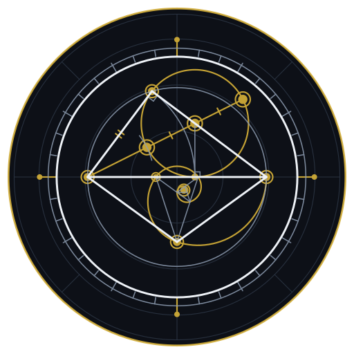

.. container:: author-overline

   semantic digital archive • mathematical catalog

=============
H. E. Huntley
=============

The mathematical catalog formalizes the geometric constructions and aesthetic proportions inspired by :person:`H. E. Huntley`'s landmark monograph *The Divine Proportion: A Study in Mathematical Beauty* (1970). Within the interconnected `GEOMETOR <https://geometor.com/books/>`_ semantic digital archive, Huntley's theorems are liberated into exact symbolic algebra over $\mathbb{Q}(\sqrt{5})$, theme-adaptive vector diagrams, and cross-corpus concordances speaking one shared geometric language.

.. reference-directory::
   :sort: order

.. toctree::
   :hidden:
   :maxdepth: 2

   catalog/index
   about/index
   people/index
   bibliography
   usage/index
   demos/index
   todos/index
   log/index
   modules/index
   glossary
   changelog
   connect
